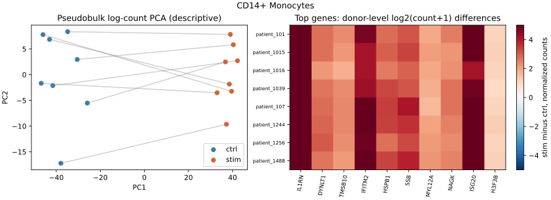
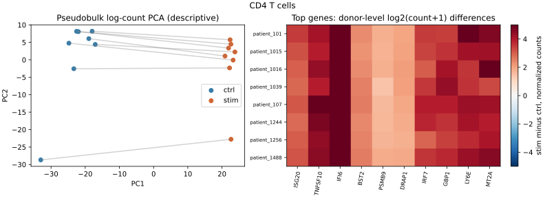

# Donor-paired PBMC interferon-response reanalysis
Run date: 2026-10-23. Published-data portfolio case study.

## Question and scope

How does the transcriptional response to ex vivo interferon-beta stimulation vary across PBMC cell types, and is the response consistent across donors? This is a reanalysis of a published processed dataset, not a new clinical discovery or an independent replication cohort.

## Data and QC

The checksum-verified processed Kang export contains 24,673 cells and 15,706 genes. A minimum of 200 detected genes retained 24,562 cells (111 excluded). All eight donors have ctrl and stim observations. The nonnegative integer matrix matches recorded RNA library totals. Cell-type labels are inherited from the processed export. Mitochondrial genes and multiplet flags are absent, so mitochondrial QC, original doublet filtering and annotation accuracy cannot be independently checked here. No integrated or SCT matrix is used for count modeling.

## Methods

Sum raw counts within each donor × condition × cell type. Retain only complete donor pairs with at least 20 cells in both conditions; require three or more pairs. Fit PyDESeq2 0.5.4 with design ~ donor + condition, contrasting stim versus ctrl. Keep genes with count >=10 in at least three pseudobulk samples. Use BH adjusted p-values within each cell type at 0.05, independent filtering and Cooks filtering. Effect sizes are unshrunken. Donors, not cells, supply biological replication. Python and R implementations are separate; numerical identity with R DESeq2 is not asserted.

## Observed results

Seven cell types met the paired-sample rule; megakaryocytes were excluded for insufficient complete pairs. The table describes model outputs, not a ranking of biological response strength: donor counts, cell abundance and statistical power differ across cell types. Multiplicity across cell types is not controlled by these within-type adjusted p-values.

| Cell type | Complete donor pairs | Genes tested | Within-type adjusted p < 0.05 |
| --- | --- | --- | --- |
| B cells | 8 | 3804 | 771 |
| CD14+ Monocytes | 8 | 5364 | 3040 |
| CD4 T cells | 8 | 7048 | 1316 |
| CD8 T cells | 5 | 2081 | 189 |
| Dendritic cells | 6 | 2089 | 708 |
| FCGR3A+ Monocytes | 6 | 2674 | 991 |
| Megakaryocytes | — | — | — |
| NK cells | 8 | 2437 | 500 |

## Illustrative expression changes

ISG15, IFIT1 and MX1 show positive fitted stimulated/control effects in CD14+ monocytes and CD4 T cells. These examples were selected for illustration after the analysis; no gene-set enrichment or pathway significance test was performed. Among each of these two cell types’ ten lowest-adjusted-p genes, all ten have positive descriptive log-normalized count differences in all eight donors. Selection from the same dataset means this is a consistency diagnostic, not independent validation.

| Cell type | Gene | Log2 fold change (stim/ctrl) |
| --- | --- | --- |
| CD14+ Monocytes | ISG15 | 7.71 |
| CD14+ Monocytes | IFIT1 | 8.67 |
| CD14+ Monocytes | MX1 | 6.18 |
| CD4 T cells | ISG15 | 5.06 |
| CD4 T cells | IFIT1 | 6.80 |
| CD4 T cells | MX1 | 4.88 |

## Sensitivity and model diagnostics

Repeat donor inclusion at 10, 20 and 50 cells per stratum. CD14+ monocyte and CD4 T-cell inclusion is unchanged at all three thresholds. Rarer populations lose pairs as the threshold rises. Where samples changed and fitting remained possible, log2-effect correlations versus primary results ranged from 0.969 to 0.994 on intersecting tested genes. Correlation does not establish identical significant-gene lists. Dendritic cells have fewer than three complete pairs at threshold 50. The threshold-10 dendritic fit falls back to a mean dispersion trend; threshold-50 CD8 and FCGR3A monocyte fits warn about low residual degrees of freedom. Primary fits emitted dependency deprecation warnings but no recorded statistical fitting warning. See fit_warnings.json for the complete record. Leave-one-donor-out tables summarize mean descriptive log-count differences; they do not refit differential-expression models or demonstrate significance robustness.

## Interpretation and limits

The observed response is consistent across donors for the selected prominent genes in the two abundant populations shown. It does not establish clinical efficacy, disease specificity, a biomarker, or that one lineage responds more strongly than another. The experiment compares treated and untreated cells from this lupus cohort; it is not lupus versus healthy. Condition-associated processing effects cannot be separated without additional experimental metadata. Large global responses can affect relative normalization: apparent decreases are relative, not absolute RNA changes. Processed gene filtering, inherited labels, missing upstream QC, small donor numbers, untested normalization sensitivity and lack of an external cohort limit inference. A formal cell-type interaction model and pathway enrichment remain future extensions.

## Reproducibility

Source: https://api.figshare.com/v2/file/download/34464122. SHA-256: e6a5adac64dcdeb36eaba27db49b63e0c64bb0ed4a64c6705971506b41c39830. The checksum matches the upstream LIANA dataset registry. The input is downloaded separately and is not redistributed with this report. The bundle includes scripts, a pinned package snapshot, complete gene tables, pseudobulk counts, donor audits, diagnostics and sensitivity outputs. Synthetic-effect, aggregation and invalid-input tests pass locally. The full observed study ran on macOS ARM64 with Python 3.12; other platforms are not yet verified. A reproduction run must be interpreted with its warnings and environment record.

## References

- [Original study](https://doi.org/10.1038/nbt.4042)
- [Upstream processed-data registry](https://github.com/saezlab/liana-py/blob/main/src/liana/datasets/registry.yaml)
- [Pertpy source documenting the Figshare export](https://github.com/scverse/pertpy/blob/0.9.5/pertpy/data/_datasets.py)
- [PyDESeq2 methods](https://pydeseq2.readthedocs.io/en/stable/auto_examples/plot_minimal_pydeseq2_pipeline.html)
